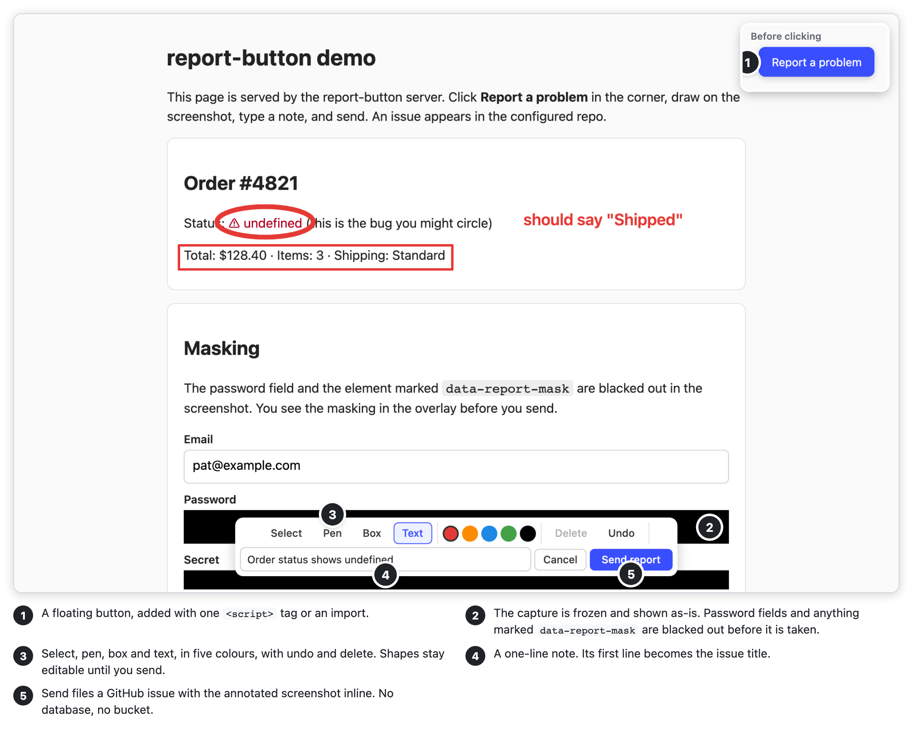
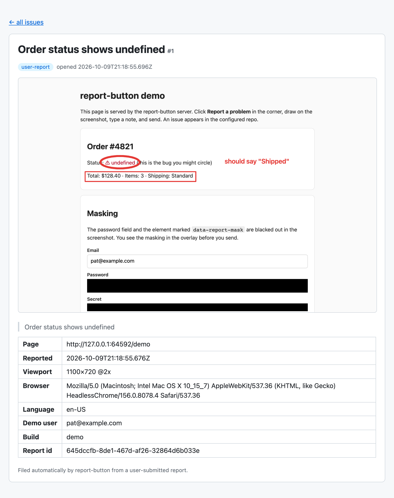

# report-button

A drop-in "Report a problem" button for any web page. The user clicks it, draws on a
screenshot of exactly what they see, types a note, and sends. It lands as a GitHub
issue with the annotated screenshot inline.

No database, no object storage. The server is a single Node process that talks only to
GitHub: the screenshot is committed to a branch in your repo and the issue links to it.

```
browser ──POST /report──▶ report-button server ──▶ commit screenshot to <repo>@report-screenshots
                                                └▶ create issue in <repo> (screenshot inline)
```



## What the user gets

- A floating button in a corner of the page.
- A frozen screenshot of the viewport to draw on: **select/move**, **pen**, **box**, **text**,
  five colours, **undo**, **delete**. Shapes stay editable until send; the result is flattened to a PNG.
- A one-line note field. Its first line becomes the issue title.
- A "sent" or "couldn't send" toast. On failure the drawing is kept so they can retry.

Password fields and anything marked `data-report-mask` are blacked out *before* the capture,
and the user sees the blacked-out version while annotating. Pages already marked up for
OpenReplay (`data-openreplay-masked`, `data-openreplay-obscured`) get the same treatment.

## Run the server

Needs Node 22+ and a GitHub token that can write issues and contents on the target repo.
A fine-grained personal access token with **Issues: write** and **Contents: write** is enough.

```bash
npm install
npm run build
GITHUB_TOKEN=github_pat_... GITHUB_REPO=you/your-app npm start
# open http://localhost:8787/demo
```

| Variable | Default | Purpose |
|---|---|---|
| `GITHUB_TOKEN` | required | Token used to create issues and commit screenshots. |
| `GITHUB_REPO` | required | `owner/name` the issues go to. |
| `GITHUB_ASSET_REPO` | `GITHUB_REPO` | `owner/name` the screenshots are committed to. Point it at a separate repo if you don't want them in the main one. |
| `GITHUB_ASSET_BRANCH` | `report-screenshots` | Branch holding the screenshots. Created as an orphan on first use, so it never touches your code history. Delete the branch to purge them. |
| `GITHUB_LABELS` | `user-report` | Comma-separated labels on every issue. Filter on these: filing is automatic. |
| `GITHUB_ASSIGNEES` | | Comma-separated GitHub logins. |
| `ALLOWED_ORIGINS` | `*` | Comma-separated page origins allowed to submit. Set it to your site's origin in production. |
| `RATE_LIMIT` | `10` | Reports per client IP per minute. `0` disables. |
| `PORT` | `8787` | |
| `GITHUB_API_URL`, `GITHUB_WEB_URL` | github.com | For GitHub Enterprise. |

Routes: `POST /report`, `GET /report-button.js` (the client bundle), `GET /demo`, `GET /health`.

### Deploy

A `Dockerfile` and `railway.json` are included. On Railway: new service from this repo, set
`GITHUB_TOKEN` and `GITHUB_REPO`, and it builds from the Dockerfile with `/health` as the
health check. Anywhere else: `docker build -t report-button . && docker run -p 8787:8787 -e GITHUB_TOKEN=... -e GITHUB_REPO=... report-button`.

## Add the button to a page

### Script tag

```html
<script src="https://reports.example.com/report-button.js"></script>
```

That's it. The endpoint defaults to `/report` on the host the script came from. Tweak with data attributes:

```html
<script src="https://reports.example.com/report-button.js"
        data-endpoint="https://reports.example.com/report"
        data-label="Something wrong?"
        data-position="bottom-left"
        data-accent="#0f766e"
        data-mask=".credit-card, [data-private]"></script>
```

| Attribute | Purpose |
|---|---|
| `data-endpoint` | Where reports are POSTed. |
| `data-label` | Button text. Default "Report a problem". |
| `data-position` | `bottom-right` (default), `bottom-left`, `top-right`, `top-left`. |
| `data-accent` | Button / active-tool colour. |
| `data-pen` | Initial pen colour. |
| `data-placeholder` | Note field placeholder. |
| `data-mask` | Extra selectors to black out, comma-separated. |
| `data-link-to-issue` | Show a "View issue" link in the confirmation toast. |
| `data-manual` | Don't auto-mount; call `ReportButton.init({...})` yourself. |

### Module

```bash
npm install github:calebcauthon/report-button
```

```js
import { init } from 'report-button'

const report = init({
  endpoint: 'https://reports.example.com/report',
  buttonLabel: 'Report a problem',
  showButton: true,          // false: trigger from your own UI with report.open()
  linkToIssue: false,        // true: toast links to the created issue
  maskSelectors: ['input[type=password]', '[data-report-mask]', '.credit-card'],
  context: () => ({          // extra rows in the issue body, gathered at send time
    User: currentUser.email,
    Build: BUILD_SHA,
  }),
  onSubmitted: ({ issueUrl, issueNumber }) => console.log('filed', issueUrl),
  onError: (err) => console.error(err),
})

report.open()     // start the flow programmatically
report.destroy()  // remove everything from the page
```

`html2canvas` is loaded on demand the first time the button is clicked, so it adds
nothing to your initial bundle.

### With OpenReplay (or any session replay)

Pass the replay link through `context` and the issue links straight to the moment:

```js
init({
  endpoint: 'https://reports.example.com/report',
  context: () => ({ Replay: tracker.getSessionURL({ withCurrentTime: true }) }),
})
```

## What ends up in the issue

```


> The note the user typed

| | |
|---|---|
| **Page** | https://app.example.com/orders/42 |
| **Reported** | 2026-10-09T15:04:05.000Z |
| **Viewport** | 1440×900 @2x |
| **Browser** | Mozilla/5.0 ... |
| **Language** | en-US |
| ...your context() rows... |
| **Report id** | <id> |
```

The `?raw=true` blob URL renders for private repos too, for anyone who can see the repo.

Rendered, it looks like this (as shown by the fake GitHub in `fixture/`, which mirrors GitHub's markdown):



## Things to know

- **The endpoint is public by design.** The reporter's browser has no credentials. Lock
  `ALLOWED_ORIGINS` to your site and keep the rate limit on. Anyone who can reach the
  endpoint can create issues in your repo, same as anyone who can see the button.
- **One click, one issue.** There is no triage step. Use the label to filter.
- **The capture is the viewport**, not the full page, and it is produced from the DOM by
  html2canvas: cross-origin images without CORS headers come out blank, and some CSS
  (filters, backdrop blur, some fonts) renders differently from the browser.
- **Screenshots are git objects.** Each report is one small commit on the asset branch.
  For a very high-volume site, point `GITHUB_ASSET_REPO` at a dedicated repo.

## Try it without a GitHub token

`fixture/` holds an in-memory fake of the slice of GitHub this server talks to. One
command boots it next to the real server and demo page:

```bash
npm run fixture
# demo page   http://localhost:8787/demo     click the button, draw, send
# fake GitHub http://localhost:8790          see the issue and screenshot that landed
```

The fake renders each issue the way GitHub would, with the screenshot inline, and
exposes `/_fixture/issues` (JSON), `/_fixture/calls` (every API request the server
made) and `/_fixture/reset`.

### End-to-end tests and screenshots

Playwright drives the real client bundle against the real server, with the fake
GitHub behind it. It boots `npm run fixture` itself.

```bash
npx playwright install chromium   # once
npm run test:e2e
```

The suite clicks the button, draws with the pen, box and text tools, types a note,
sends, and then asserts what reached the fake GitHub: the title, the context rows,
and that the linked image is a real PNG. It also checks that the password field is
black in the capture, that cancel files nothing, that undo and delete work, and that
a server failure keeps the drawing on screen. Each run writes `e2e/screenshots/`:

| | |
|---|---|
| `1-page.png` | the demo page with the button |
| `2-overlay.png` | the frozen capture with the toolbar |
| `3-annotated.png` | after drawing and typing a note |
| `4-sent.png` | the confirmation toast |
| `5-issue.png` | the issue as rendered by the fake GitHub |
| `6-masking.png` | password and `data-report-mask` blacked out |
| `7-failed.png` | the failure toast with the overlay kept |

## Development

```bash
npm run dev        # builds the client, runs the server from source with --watch
npm test           # node:test unit tests against the fake GitHub
npm run test:e2e   # Playwright, see above
npm run test:all
npm run typecheck
npm run build      # dist/report-button.js (script tag), dist/report-button.esm.js, dist/server.js
npm run readme-images  # regenerate docs/annotate.png and docs/issue.png from a live run
```

## Origin

Extracted from an OpenReplay fork, where it lived as a tracker plugin backed by OpenReplay's
Python API, Postgres and S3. This repo keeps the button, the annotation tools and the
GitHub filing, and drops everything else.

MIT.
